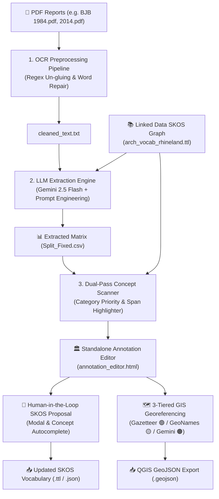

# 🏛️ ArchaeoExtract-Rhineland

**Automated Archaeological Text Mining, SKOS Normalization & Tiered GIS Georeferencing Pipeline for the *Bonner Jahrbücher* (BJB)**

[](https://www.python.org/)
[](https://ai.google.dev/)
[](https://www.w3.org/2004/02/skos/)
[](LICENSE)

---

## 📌 Executive Summary & Project Vision

**ArchaeoExtract-Rhineland** is an end-to-end NLP and AI-driven pipeline designed for extracting, structuring, and georeferencing historical archaeological excavation reports from the *Bonner Jahrbücher* (BJB), published by the *LVR-Landesmuseum Bonn* and digitized at the **[Heidelberg University Library Digital Repository](https://journals.ub.uni-heidelberg.de/index.php/bjb/index)**.

Archaeological excavation reports pose unique NLP challenges:
* **Complex Multi-Column OCR Artifacts**: Glued prepositions, concatenated German compound words (e.g., `spätbronzezeitlich/früh-eisenzeitlich`, `neolith.u.`), and OCR hyphenation breaks.
* **Domain-Specific Vocabulary & Typologies**: Roman emperor coin titles (*Augustus*, *Caligula*, *Marc Aurel*), vessel ceramic typologies (*Niederbieber 67b*, *Terra Sigillata*), and infrastructure (*Eifelwasserleitung*, *Fundamentplatte*, *Spitzgraben*).
* **Relative Chronologies & Combined Dates**: Complex temporal spans (*Hallstatt C–Frühlatènezeit*, *2./3. Jh. n. Chr.*).
* **Micro-Toponyms & Un-Geocoded Field Names**: Local field names (*"Merzenicher Heide"*, *"Im Kamp"*) lacking standard gazetteer coverage.

This project addresses these challenges through a **hybrid AI + SKOS Knowledge Graph architecture**, combining LLM context processing with strict domain vocabulary constraints, a standalone interactive annotation editor (`annotation_editor.html`), and a **3-tiered GIS georeferencing pipeline**.

---

## 📥 Input & 📤 Output Data Specifications

### 📥 Input Data Formats
1. **Digitized PDF Reports (`*.pdf`)**: Full-volume scans from the [Heidelberg University Library BJB Archive](https://journals.ub.uni-heidelberg.de/index.php/bjb/index).
2. **SKOS Knowledge Graph (`arch_vocab_rhineland.ttl`)**: Turtle RDF authority file defining concepts, hierarchies (`skos:broader`), prefLabels, and altLabels.
3. **Rhineland Gazetteer (`gaz_rheinland.csv`)**: Municipalities and coordinates dataset containing WGS84 (`Lat`/`Lon`) and ETRS89 (`X_ETRS89`/`Y_ETRS89`) spatial data.

### 📤 Output Data Artifacts
1. **Relational Extraction Matrix (`LVR_[Year]_Split_Fixed.csv`)**: Semicolon-separated table with fields: `Seitenzahl`, `ort`, `kreis`, `massnahme_id`, `datierung_norm`, `befunde_norm`, `funde_norm`, `autor`.
2. **Repaired Text Stream (`LVR_[Year]_cleaned_text.txt`)**: OCR-cleaned text stream with restored word breaks and stripped figure captions.
3. **Interactive Web Application (`annotation_editor.html`)**: Self-contained web editor featuring dual-pane text highlighting, human-in-the-loop SKOS proposals, and 3-tiered GIS mapping.
4. **QGIS GeoJSON Layer (`archaeo_sites_[Doc].geojson`)**: `FeatureCollection` spatial layer with Point geometries and verification tier badges for GIS workflows.
5. **Updated SKOS Graph Export (`arch_vocab_rhineland_updated.json`)**: User-extended vocabulary definitions including new `skos:broader` relationships.

---

## 🏗️ System Architecture



---

## 🔥 Key Pipeline Features

### 1. 🧹 Smart OCR Preprocessing & Word Un-gluing
* Automatically identifies and splits glued OCR terms (`neolith.u.` → `neolithisch u.`, `spätbronze-` → `spätbronzezeitlich`, `Trassederröm.` → `Trasse der röm.`).
* Strips figure captions, scale bars, and header/footer noise without losing excavation context.

### 2. 🧠 Single-Source SKOS Knowledge Graph Authority
* Powered dynamically by **`arch_vocab_rhineland.ttl`** (RDF/Turtle).
* Concept hierarchies cover **Chronologies (`Datierung`)**, **Features (`Befund`)**, and **Artifacts (`Fund`)**.
* Maps Roman emperors (*Augustus*, *Tiberius*, *Claudius I.*), typologies (*Niederbieber*, *Gellep*, *Dragendorff*), and structures (*Wasserleitung*, *Pfostengrube*, *Graben*).

### 3. 🎨 2-Pass Entity Scanner & Priority Highlighting
* **Right-to-Left Non-Overlapping Span Engine**: Eliminates HTML rendering corruption from nested tags.
* **Category Priority Enforcement**:  
  $$\text{Datierung (🟨)} > \text{Befund (🟥)} > \text{Fund (🟩)} > \text{Aktivität (🟦)} > \text{Ort (⬜)}$$
* **Negative Phrase Exclusion**: Prevents false-positive highlights on negative statements (e.g., *"keine Funde"*, *"ohne Befund"*).

### 4. 📖 Human-in-the-Loop SKOS Candidate Proposal
* Highlight any unrecognized term in the reader view to launch the **SKOS Concept Proposal Modal**.
* **Broader Concept Search (`skos:broader`)**: Searchable autocomplete input connected to all existing SKOS concepts.
* **Instant Document Re-scanning**: Newly created terms immediately re-scan the active document and highlight all occurrences across the text!

### 5. 🗺️ 3-Tiered GIS Georeferencing Pipeline
* **Tier 1: Rheinland Gazetteer (`gaz_rheinland.csv`)** 🟢  
  Auto-verified matching against 304+ Rhineland municipalities with ETRS89/WGS84 coordinates.
* **Tier 2: GeoNames & Nominatim Search API** 🟡  
  Queries OpenStreetMap/GeoNames for candidates not found in Tier 1. Pins are rendered on Leaflet map for 1-click archaeologist verification.
* **Tier 3: Gemini AI Fallback for Micro-Toponyms** 🟠  
  Proposes estimated coordinates for local field names (*"Merzenicher Heide"*).
* **📍 Drag-and-Drop Pinpointing**: Drag markers on the map to pinpoint exact excavation trench boundaries.
* **📥 QGIS GeoJSON Export**: Export all verified excavation sites as a clean `.geojson` layer for QGIS/ArcGIS.

---

## 📁 Repository Structure

```
e:\AIBJB/
├── Extraction_pipline_BJB.py     # Main Gemini LLM extraction pipeline
├── OCR_Preprocessing_Pipeline.py # Regex OCR word un-gluing & text cleanup
├── build_standalone_editor.py    # Generates standalone annotation_editor.html
├── generate_preview.py           # Generates static HTML highlighting previews
├── arch_vocab_rhineland.ttl      # Core SKOS RDF Knowledge Graph (Turtle)
├── gaz_rheinland.csv             # Rhineland Gazetteer (ETRS89/WGS84)
├── vocabularies.json             # Serialized JSON vocabulary cache
├── annotation_editor.html        # Interactive Standalone Web Application
├── LVR_2014_10_16_cleaned_text.txt # Processed text for Volume 2014
├── LVR_2014_10_16_Split_Fixed.csv  # Extracted CSV matrix for Volume 2014
├── LVR_1984_cleaned_text.txt       # Processed text for Volume 1984
├── LVR_1984_Split_Fixed.csv        # Extracted CSV matrix for Volume 1984
├── README.md                     # Project documentation
└── WIKI.md                       # Deep-dive technical wiki
```

---

## ⚡ Quickstart & Installation

### 1. Requirements & Dependencies
Python 3.10+ is required. Install dependencies via `pip`:

```bash
pip install pandas google-genai rdflib pdfplumber tqdm
```

### 2. Configure Google Gemini API Key
Set your Gemini API key as an environment variable or place it inside `google_API.txt`:

```bash
# Windows PowerShell
$env:GOOGLE_API_KEY="YOUR_API_KEY_HERE"

# Linux / macOS
export GOOGLE_API_KEY="YOUR_API_KEY_HERE"
```

### 3. Run the Extraction Pipeline
To run extraction for a full BJB volume (e.g., `1984.pdf` or `2014_10_16.pdf`):

```bash
python Extraction_pipline_BJB.py 1984.pdf
```

### 4. Build/Open the Annotation Editor
To rebuild the standalone web editor containing all extracted volumes, gazetteer data, and Leaflet GIS mapping:

```bash
python build_standalone_editor.py
```

Then open **[`annotation_editor.html`](file:///e:/AIBJB/annotation_editor.html)** in any modern web browser!

---

## 📄 License & Citation

Distributed under the **MIT License**. See `LICENSE` for more information.

When referencing this pipeline in academic research:
```bibtex
@software{archaeoextract_rhineland_2026,
  author = {Archaeological Text Mining Team},
  title = {ArchaeoExtract-Rhineland: Automated Archaeological Text Mining, SKOS Normalization & Tiered GIS Georeferencing Pipeline},
  year = {2026},
  publisher = {GitHub},
  url = {https://github.com/mlangsqrldev/archaeo_text_extraction}
}
```
