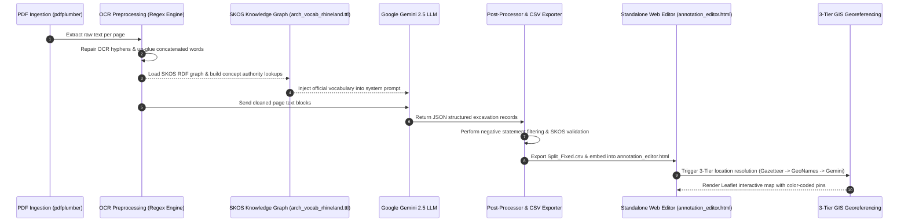
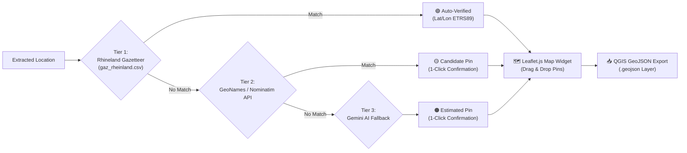

# 📚 ArchaeoExtract-Rhineland: Technical Wiki & System Specification

Welcome to the technical wiki for **ArchaeoExtract-Rhineland**. This document provides an exhaustive, deep-dive specification of the pipeline architecture, natural language processing algorithms, Knowledge Graph ontology models, human-in-the-loop workflows, and 3-tiered GIS georeferencing system.

---

## 📋 Table of Contents

1. [Domain Background & Objectives](#1-domain-background--objectives)
2. [End-to-End Execution Sequence](#2-end-to-end-execution-sequence)
3. [Knowledge Representation & SKOS RDF Ontology](#3-knowledge-representation--skos-rdf-ontology)
4. [OCR Preprocessing & Text Cleaning Engine](#4-ocr-preprocessing--text-cleaning-engine)
5. [Dual-Pass Entity Scanning & Priority Highlighting](#5-dual-pass-entity-scanning--priority-highlighting)
6. [Human-in-the-Loop SKOS Proposal Architecture](#6-human-in-the-loop-skos-proposal-architecture)
7. [3-Tiered GIS Georeferencing & Spatial Resolution](#7-3-tiered-gis-georeferencing--spatial-resolution)
8. [Developer Guide & Extending the System](#8-developer-guide--extending-the-system)

---

## 1. Domain Background & Objectives

The *Bonner Jahrbücher* (BJB), published by the *LVR-Landesmuseum Bonn* and digitized at the **[Heidelberg University Library Digital Repository](https://journals.ub.uni-heidelberg.de/index.php/bjb/index)**, constitutes one of the most significant digital repositories of archaeological research and excavation reports in the German Rhineland region. Each volume contains hundreds of excavation reports (*Jahresberichte* / *Fundchronik*) detailing:
- **Administrative measures & sites (`Ort / Kreis / Maßnahme`)**: Municipality, district, site name, TK map sheet numbers, and coordinates.
- **Temporal chronologies (`Datierung`)**: Temporal periods, cultural phases (*Michelsberger Kultur*, *Hallstatt C*, *Frühlatènezeit*), Roman emperors (*Augustus*, *Caligula*, *Marc Aurel*), and absolute century ranges (*2./3. Jh. n. Chr.*).
- **In-situ features (`Befund`)**: Immovable archaeological structures (*Wasserleitung*, *Fundamentplatte*, *Pfostengrube*, *Spitzgraben*, *Brandgrab*, *Villa rustica*).
- **Recovered artifacts (`Fund`)**: Movable objects (*Terra Sigillata*, *Niederbieber 67b*, *Glanztonwarebecher*, *Einhenkelkrug*, *Sesterz*, *Denar*).

### NLP Challenges Addressed:
1. **Concatenated OCR Words**: Legacy OCR scans concatenate German prepositions and compound nouns (e.g., `neolith.u.`, `spätbronzezeitlich/früheisenzeitlich`, `Trassederröm.`).
2. **Negative Statement False Positives**: Phrases like *"keine Funde"* or *"ohne Befund"* must not generate positive artifact/feature badges.
3. **Compound & Combined Chronologies**: Dates often span multi-phase periods (e.g., *"urnenfelder- bis frühlatènezeitlich"*).
4. **Micro-Toponyms**: Local field names (*"Merzenicher Heide"*, *"Im Kamp"*) lacking entry in national gazetteers.

---

## 2. End-to-End Execution Sequence



---

## 3. Knowledge Representation & SKOS RDF Ontology

The normalization authority is governed dynamically by **`arch_vocab_rhineland.ttl`**, sourced from the official **[BCDH HECTOR Editor SKOS Vocabularies Repository](https://github.com/bcdhbonn/hector-editor-skos)**. It represents a W3C SKOS (Simple Knowledge Organization System) RDF Knowledge Graph serialized in Turtle format.

### Concept Hierarchy Structure:
- **`skos:ConceptScheme`**: Rhineland Archaeological Vocabulary
- **Top Concepts**:
  - `Datierung` (`concept_4de8f3b0`): Epochs, Roman emperors, absolute centuries.
  - `Befund` (`concept_4c5049c7`): Structures, pits, ditches, walls, graves.
  - `Fund` (`concept_e9dddde8`): Pottery, coins, weapons, ornaments.

### Dynamic Turtle Parsing Logic (`Extraction_pipline_BJB.py`):
```python
# Graph traversal to resolve top-level category via skos:broader relations
def get_category(concept, visited=None):
    c_str = str(concept)
    if c_str in cat_map: return cat_map[c_str]
    for b in g.objects(concept, SKOS.broader):
        cat = get_category(b, visited)
        if cat: return cat
    return None
```

### Numismatic & Imperial Authority Mapping:
Roman imperial coin titles in text reports are automatically mapped to canonical SKOS prefLabels:
- `"Konstantin der Große"` / `"Constantin I."` → `Constantin I. (SKOS)`
- `"Marc Aurel"` / `"Marcus Aurelius"` → `Mark Aurel (SKOS)`
- `"Philippus Arabs"` / `"Philippus I."` → `Philippus Arabs (SKOS)`

---

## 4. OCR Preprocessing & Text Cleaning Engine

`OCR_Preprocessing_Pipeline.py` applies explicit regex transformation rules prior to LLM processing:

| Input Glued OCR Term | Processed Output | Explanation |
| :--- | :--- | :--- |
| `neolith.u.` | `neolithisch u.` | Un-glues shorthand conjunctions |
| `spätbronze-` | `spätbronzezeitlich` | Expands truncated hyphenated compound adjectives |
| `früheisenzeitl.` | `früheisenzeitlich` | Standardizes German archaeological suffixes |
| `Trassederröm.` | `Trasse der röm.` | Restores missing whitespace in prepositions |
| `Materialentnahmebereichenachgewiesen.` | `Materialentnahmebereiche nachgewiesen.` | Splits concatenated nouns and verbs |
| `Schützengrabenmiteinzelnen` | `Schützengraben mit einzelnen` | Un-glues concatenated prepositions |
| `2./3. Jh.n. Chr.` | `2. / 3. Jh. n. Chr.` | Standardizes date boundaries |

---

## 5. Dual-Pass Entity Scanning & Priority Highlighting

To generate non-corrupting HTML rendering in `annotation_editor.html`, the text scanner employs a **2-pass right-to-left span generator**:

### Category Priority Ranking:
$$\text{Datierung (🟨)} > \text{Befund (🟥)} > \text{Fund (🟩)} > \text{Aktivität (🟦)} > \text{Ort (⬜)}$$

### Right-to-Left Non-Overlapping Substring Algorithm:
```javascript
// Sort spans descending by start position to safely assemble HTML string
spans.sort((a, b) => b.start - a.start);

let currPos = rawText.length;
for (let s of spans) {
    const afterText = escapeHtml(rawText.substring(s.end, currPos));
    const spanText = escapeHtml(rawText.substring(s.start, s.end));
    // Build tagged <mark> element
    currPos = s.start;
}
```

### Negative Statement Exclusion:
Negative expressions are strictly excluded from generating false positive entity badges:
```python
if re.search(r'\b(keine|kein|ohne|keinerlei)\s+$', raw_text[:start], re.IGNORECASE):
    continue  # Skip highlighting false positives like "keine Funde"
```

---

## 6. Human-in-the-Loop SKOS Proposal Architecture

When an archaeologist encounters an unmapped typology or new term in the reader view:

1. **Selection Trigger**: Highlighting text in the reader pane displays the floating popup toolbar:  
   👉 **`[ 📖 Ins SKOS-Vokabular aufnehmen... ]`**
2. **Modal Form**:
   - **PrefLabel**: Term name (e.g., `Niederbieber 67b`).
   - **Category**: Dropdown (`Datierung`, `Befund`, `Fund`).
   - **AltLabels**: Comma-separated synonyms.
   - **`skos:broader` Autocomplete**: Live searchable dropdown (`<datalist id="broaderConceptsList">`) populated with all existing SKOS concepts.
3. **Live Re-scanning**:  
   Clicking **`[ 💾 In Vokabular speichern & Text scannen ]`** appends the concept to `rawVocabularies`, triggers an instant text scan across `raw_text`, and highlights all occurrences in yellow/red/green!
4. **Persistence**: Saves edits to `localStorage` and provides **`[ 📥 Vokabular TTL/JSON Export ]`**.

---

## 7. 3-Tiered GIS Georeferencing & Spatial Resolution

To place excavation sites onto interactive maps and export spatial datasets:



### Tier Specifications:
- **Tier 1: Rheinland Gazetteer (`gaz_rheinland.csv`) 🟢**:  
  Matches against 304+ verified Rhineland municipalities. High confidence, direct coordinate assignment.
- **Tier 2: GeoNames & Nominatim API 🟡**:  
  Asynchronous lookup for places outside the gazetteer. Renders candidate yellow pins on Leaflet map.
- **Tier 3: Gemini AI Fallback 🟠**:  
  Handles micro-toponyms (*"Merzenicher Heide"*, *"Im Kamp"*). Renders candidate orange pins.
- **📍 Drag-and-Drop Pinpointing**: Enables manual pin relocation to pinpoint exact field trenches.
- **📥 GeoJSON Export**: Exports spatial features (`FeatureCollection` of `Point` geometries) for QGIS/ArcGIS.

---

## 8. Developer Guide & Extending the System

### Rebuilding the Standalone Annotation Editor
Whenever new extraction CSVs or cleaned text files are produced, run:

```bash
python build_standalone_editor.py
```

This automatically scans for all `LVR_*_Split_Fixed.csv` files, parses `gaz_rheinland.csv`, embeds the 2-pass scanner, and creates **`annotation_editor.html`**.

### Adding a New BJB Volume
1. Place the PDF (e.g., `1995.pdf`) inside `pdf_base_dir`.
2. Execute:
   ```bash
   python Extraction_pipline_BJB.py 1995.pdf
   ```
3. The pipeline will output `LVR_1995_Split_Fixed.csv` and automatically update `annotation_editor.html`.
